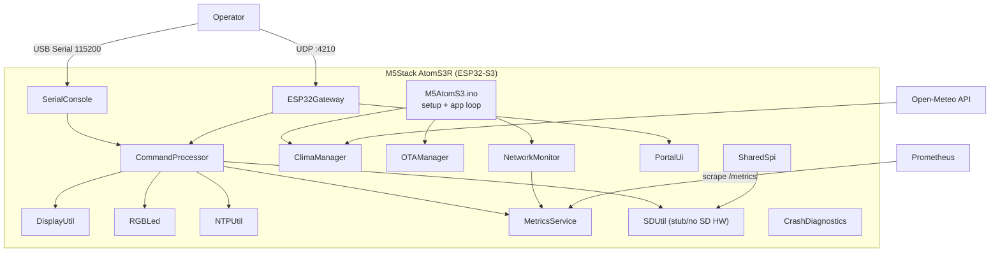
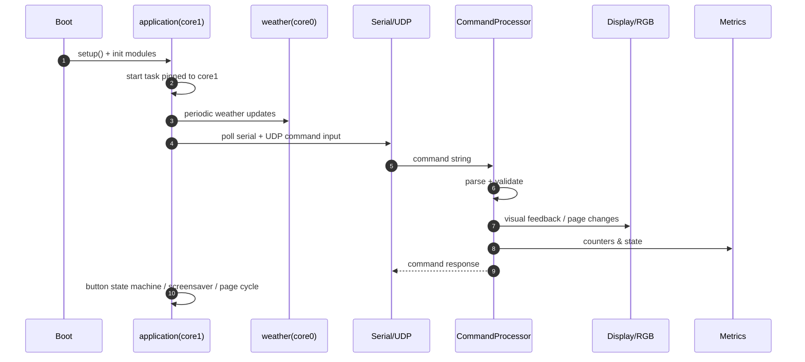
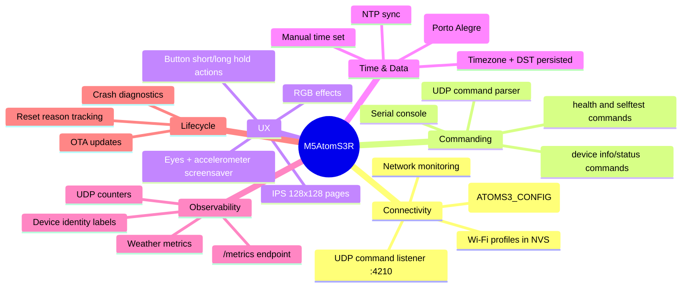
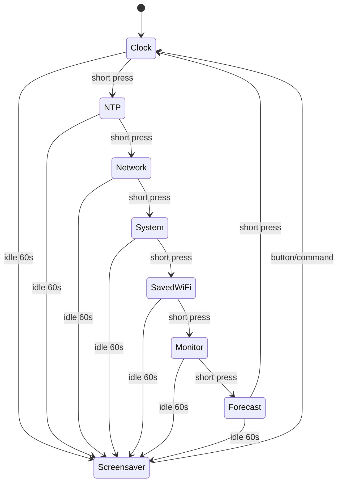
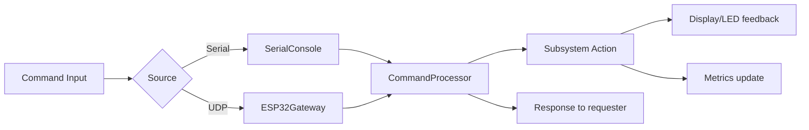
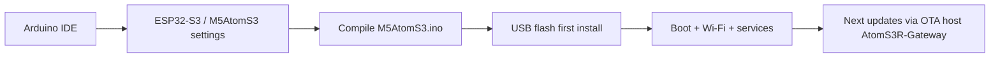

# 🚀 M5AtomS3R — Premium Edge Gateway Firmware for ESP32-S3

<div align="center">


[](https://github.com/paulocfmarques-collab/M5AtomS3R)
[](https://github.com/paulocfmarques-collab/M5AtomS3R/commits/main)
[](https://github.com/paulocfmarques-collab/M5AtomS3R/issues)
[](https://github.com/paulocfmarques-collab/M5AtomS3R/pulls)

</div>

---

## ✨ Overview

**M5AtomS3R** is a production-style firmware for **M5Stack AtomS3R (ESP32-S3)** focused on:

- resilient network gateway behavior,
- serial + UDP command execution,
- local UX (display, button, RGB effects, screensaver with accelerometer),
- OTA update support,
- observability with Prometheus metrics,
- weather data integration (Open-Meteo, Porto Alegre profile),
- operational diagnostics and stability tooling.

Repository: **`paulocfmarques-collab/M5AtomS3R`**  
Default branch: **`main`**  
Primary language: **C++**

---

## 🗺️ Table of Contents

- [System Architecture](#-system-architecture)
- [Runtime Flow](#-runtime-flow)
- [Repository Map](#-repository-map)
- [Feature Matrix](#-feature-matrix)
- [Display & Input UX](#-display--input-ux)
- [Command Channels](#-command-channels)
- [Prometheus & Telemetry](#-prometheus--telemetry)
- [Build & Flash](#-build--flash)
- [Operation Endpoints](#-operation-endpoints)
- [Project Documents](#-project-documents)
- [Notes & Limitations](#-notes--limitations)

---

## 🧱 System Architecture



---

## 🔄 Runtime Flow



---

## 🗂️ Repository Map

### Core firmware files

| File | Purpose |
|---|---|
| `M5AtomS3.ino` | Main boot/setup/task loop, button behavior, page flow, OTA handling |
| `CommandProcessor.h/.cpp` | Command parser, dispatch and command execution logic |
| `ESP32Gateway.h/.cpp` | Wi-Fi gateway behavior, UDP commands, portal client handling |
| `MetricsService.h/.cpp` | Prometheus-style metrics export and counters |
| `NetworkMonitor.h/.cpp` | Link/network diagnostics and monitoring helpers |
| `NTPUtil.h/.cpp` | Time sync, timezone and DST handling |
| `DisplayUtil.h/.cpp` | Screen pages, UI rendering, screensaver face/eyes |
| `RGBLed.h/.cpp` | RGB control/effects via LP5562 channels |
| `OTAManager.h` | OTA initialization and progress handling |
| `ClimaManager.h` | Weather cache/update strategy (Open-Meteo) |
| `CrashDiagnostics.h/.cpp` | Crash and reset diagnostics |
| `PortalUi.h` | Web portal UI and route-level rendering |
| `SerialConsole.h` | Serial line ingestion and command extraction |
| `SDUtil.h/.cpp` | SD API compatibility (board has no built-in microSD reader) |
| `SharedSpi.h` | Shared SPI bus coordination |

### Documentation assets

| File | Description |
|---|---|
| `README.md` | Main project overview (this document) |
| `LEIA-ME.md` | Detailed Portuguese operational guide |
| `comandos.md` | Full command catalog and operational semantics |
| `comandos.pdf` | Command guide in PDF format |
| `PROMETHEUS.md` | Metrics definitions and PromQL examples |
| `PROMETHEUS.pdf` | Prometheus guide in PDF format |
| `changelog.md` | Local change history |

---

## 🧩 Feature Matrix



---

## 🖥️ Display & Input UX

### Display pages (logical indices)

| Page | Content |
|---|---|
| `0` | Clock + IP + weather temperature |
| `1` and `2` | NTP / date-time / timezone / DST |
| `3` and `4` | Network information |
| `5` | System info, heap/PSRAM, uptime |
| `6` | Saved Wi-Fi profiles |
| `7` | SD unavailable notice |
| `8` | Network monitor |
| `9` | Porto Alegre forecast |

### Button behavior

- **Short press**: next distinct page (skips duplicates and SD placeholder in normal navigation).
- **Hold ~3s and release**: reboot.
- **Hold ~10s and release**: clear Wi-Fi profiles and reboot.
- **Idle ~60s**: eyes screensaver engages.
- **~20s after navigation inactivity**: returns to clock page.



---

## 📨 Command Channels

The firmware processes commands from two equivalent sources:

1. **USB Serial** (115200 baud)
2. **UDP** to device IP on port **4210**

Input limit is **255 bytes** per command.  
Canonical command documentation is in [`comandos.md`](./comandos.md).

### High-level command groups

- system/diagnostic (`info`, `status`, `health`, `selftest`, `reboot`, `crash_info`, ...)
- network/Wi-Fi (`wifi_add`, `wifi_list`, `wifi_status`, `net_info`, `reset_wifi`, ...)
- display/brightness (`tela`, `tela_next`, `rotacao`, `brilho`, `tela_on`, `tela_off`)
- time/NTP (`time`, `date`, `ntp_status`, `set_fuso`, `dst_on`, `dst_off`, `set_time`)
- RGB (`led_on`, `led_off`, `led_rgb`, `led_breath`, `led_pisca`, `led_blink`)
- weather (`clima`, `clima_age`, `previsao`, `clima_sync`)



---

## 📡 Prometheus & Telemetry

Detailed reference is in [`PROMETHEUS.md`](./PROMETHEUS.md).

### Metrics families highlighted by the repo docs

- UDP health/counters:
  - `esp_udp_listener_up`
  - `esp_udp_packets_received_total`
  - `esp_udp_replies_sent_total`
  - `esp_udp_send_errors_total`
- Weather/device:
  - `sensor_temperature_celsius{source="open_meteo",location="porto_alegre"}`
  - `sensor_humidity_percent{source="open_meteo",location="porto_alegre"}`
  - `esp_info{model="M5Stack-AtomS3R"}`

```mermaid
flowchart TD
    S1[UDP listener] --> M[MetricsService]
    S2[Command execution] --> M
    S3[Network monitor] --> M
    S4[Weather cache] --> M
    M --> E[/metrics endpoint]
    E --> P[Prometheus scrape]
    P --> D[Dashboards + alerts]
```

---

## 🛠️ Build & Flash

From project docs (`LEIA-ME.md`):

- Board package reference: **esp32 by Espressif Systems 3.3.12**
- Board selection: **M5AtomS3** (M5Unified identifies AtomS3R)
- Flash: **8MB (64Mb)**
- PSRAM: **OPI PSRAM**
- Partitions: **8M with spiffs (3MB APP/1.5MB SPIFFS), OTA-compatible**
- Arduino runs on **Core 1**, events on **Core 0**



---

## 🌐 Operation Endpoints

| Service | Endpoint / Value |
|---|---|
| AP SSID (config mode) | `ATOMS3_CONFIG` |
| AP Wi-Fi config page | `http://192.168.4.1/wifi` |
| Portal root (station mode) | `http://IP_DA_PLACA/` |
| Portal Prometheus settings | `http://IP_DA_PLACA/prometheus` |
| Metrics endpoint | `http://IP_DA_PLACA:9120/metrics` *(default port; configurable)* |
| UDP command socket | `IP_DA_PLACA:4210` |
| OTA hostname | `AtomS3R-Gateway` |

---

## 📚 Project Documents

- [`LEIA-ME.md`](./LEIA-ME.md) — setup details and device behavior notes
- [`comandos.md`](./comandos.md) — full command contract
- [`PROMETHEUS.md`](./PROMETHEUS.md) — metrics and PromQL examples
- [`changelog.md`](./changelog.md) — change history

---

## ⚠️ Notes & Limitations

- AtomS3R has **no built-in microSD reader** in this adaptation; `sd_*` commands return unavailable.
- UDP and web configuration flows are intended for trusted networks.
- OTA password is not described as enabled in docs.
- Weather profile/documentation is currently centered on **Porto Alegre**.
- Main logic is task-driven with explicit multi-core behavior (app core + weather core).

---

## 🤝 Contributing

Contributions are welcome.

1. Fork repository.
2. Create a feature branch.
3. Keep commits focused and descriptive.
4. Open a PR with hardware validation notes when applicable.

---

## 🔗 Repository

- GitHub: https://github.com/paulocfmarques-collab/M5AtomS3R
