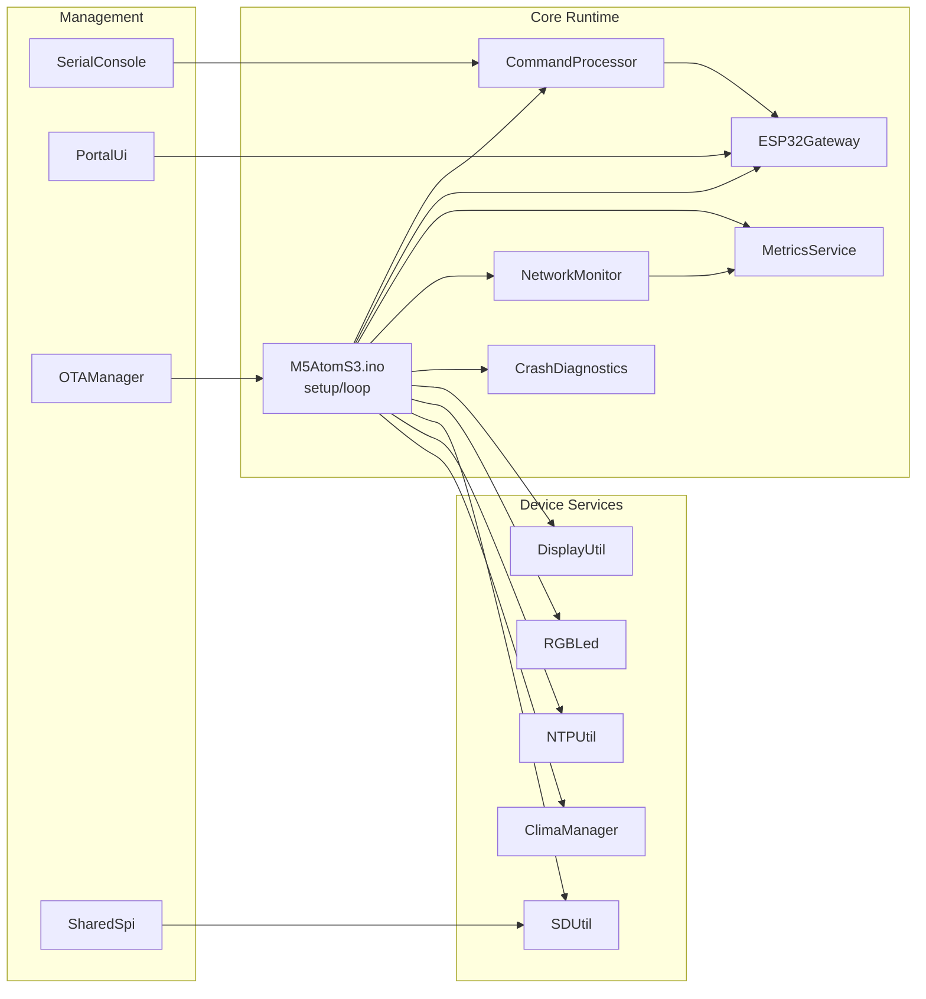
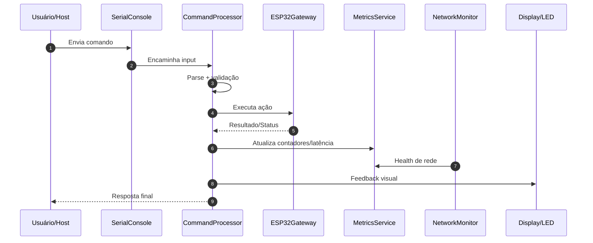
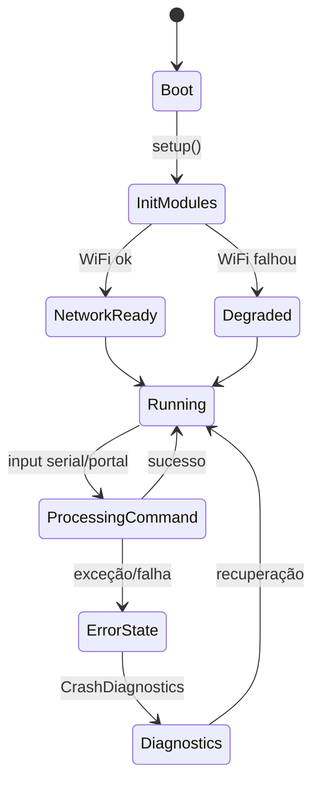
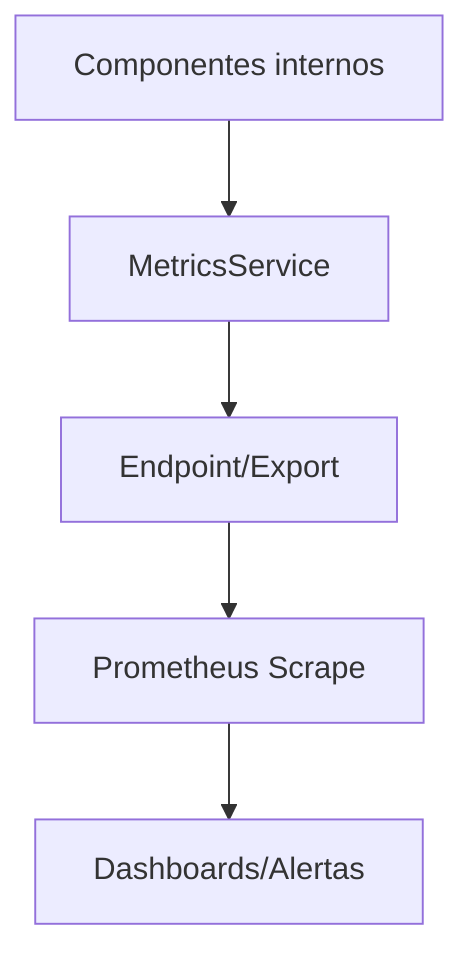

# ⚡ M5AtomS3R — Edge Gateway Inteligente para ESP32-S3

<div align="center">


<br />

[](https://github.com/paulocfmarques-collab/M5AtomS3R)
[](https://github.com/paulocfmarques-collab/M5AtomS3R/commits/main)
[](https://github.com/paulocfmarques-collab/M5AtomS3R/issues)
[](https://github.com/paulocfmarques-collab/M5AtomS3R/pulls)
[](https://github.com/paulocfmarques-collab/M5AtomS3R/stargazers)

</div>

---

## 🧠 O que este projeto entrega

O **M5AtomS3R** é um firmware modular para **M5AtomS3 / ESP32-S3** voltado para operação em borda (edge), com foco em:

- **conectividade robusta** (monitoramento e saúde de rede),
- **execução de comandos** (serial/console),
- **telemetria e métricas** (incluindo integração com Prometheus),
- **diagnóstico de falhas** e suporte operacional em campo,
- **feedback visual local** (display + LED RGB),
- **utilitários de infraestrutura** (SD, NTP, gateway e OTA-ready).

---

## 🗂️ Sumário

- [Arquitetura](#-arquitetura)
- [Estrutura do repositório](#-estrutura-do-repositório)
- [Stack técnica](#-stack-técnica)
- [Como compilar e gravar](#-como-compilar-e-gravar)
- [Fluxo operacional](#-fluxo-operacional)
- [Observabilidade](#-observabilidade)
- [Quick Commands](#-quick-commands)
- [Troubleshooting](#-troubleshooting)
- [Roadmap](#-roadmap)
- [Documentos auxiliares](#-documentos-auxiliares)
- [Contribuição](#-contribuição)
- [Licença](#-licença)

---

## 🧱 Arquitetura

### Visão macro de componentes



### Fluxo de execução (comando → ação → métrica)



---

## 📁 Estrutura do repositório

| Arquivo | Responsabilidade |
|---|---|
| `M5AtomS3.ino` | Orquestração principal do firmware (boot, setup, loop) |
| `CommandProcessor.h/.cpp` | Parsing e execução de comandos |
| `ESP32Gateway.h/.cpp` | Camada de integração/gateway |
| `MetricsService.h/.cpp` | Coleta e exposição de métricas |
| `NetworkMonitor.h/.cpp` | Monitoramento de saúde da rede |
| `CrashDiagnostics.h/.cpp` | Diagnóstico e rastreio de falhas |
| `DisplayUtil.h/.cpp` | Renderização de informações no display |
| `RGBLed.h/.cpp` | Sinalização por LED RGB |
| `SDUtil.h/.cpp` | Persistência/IO em cartão SD |
| `NTPUtil.h/.cpp` | Sincronização de horário (NTP) |
| `ClimaManager.h` | Gestão de contexto climático/dados ambientais |
| `OTAManager.h` | Estrutura para atualização OTA |
| `PortalUi.h` | Interface de portal/configuração |
| `SerialConsole.h` | Console serial para operação e debug |
| `SharedSpi.h` | Compartilhamento de barramento SPI |
| `PROMETHEUS.md` | Guia de observabilidade/métricas |
| `comandos.md` / `comandos.pdf` | Catálogo de comandos operacionais |
| `changelog.md` | Histórico de evolução do projeto |
| `LEIA-ME.md` | Documentação complementar em português |

---

## 🛠️ Stack técnica

| Item | Tecnologia |
|---|---|
| Hardware alvo | M5AtomS3 (ESP32-S3) |
| Linguagem | C++ (Arduino) |
| Runtime | Arduino Core para ESP32 |
| Telemetria | Prometheus-style metrics |
| Persistência local | SD Card |
| Sincronização de tempo | NTP |
| Operação | Serial Console + UI local |

---

## 🚀 Como compilar e gravar

### Opção A — Arduino IDE

1. Abra `M5AtomS3.ino`.
2. Selecione placa **ESP32-S3 / M5AtomS3**.
3. Configure a porta serial correta.
4. Compile e faça upload.
5. Abra o monitor serial para operação e diagnóstico.

### Opção B — PlatformIO (se aplicável no seu setup)

```bash
pio run
pio run -t upload
pio device monitor
```

> Se seu ambiente exigir parâmetros específicos de flash/partição, mantenha-os alinhados com sua configuração atual de ESP32-S3.

---

## 🔄 Fluxo operacional



---

## 📡 Observabilidade

A documentação detalhada está em **`PROMETHEUS.md`**.

### Indicadores esperados (exemplos de domínio)

- disponibilidade de rede/dispositivo;
- execução e status de comandos;
- contadores de erro/falha;
- eventos de gateway e latência de operação.

### Arquitetura de métricas



---

## ⚡ Quick Commands

> Fonte de verdade: **`comandos.md`** e **`comandos.pdf`**.  
> A tabela abaixo é um template premium para organizar seus comandos mais usados.

| Categoria | Comando | Descrição | Exemplo | Retorno esperado |
|---|---|---|---|---|
| Sistema | `status` | Estado geral do dispositivo | `status` | uptime, rede, saúde |
| Rede | `net` | Diagnóstico de conectividade | `net` | IP, RSSI, estado Wi-Fi |
| Tempo | `ntp` | Status de sincronização NTP | `ntp` | horário atual/sync |
| Métricas | `metrics` | Estado da telemetria | `metrics` | contadores e flags |
| Armazenamento | `sd` | Testes/operações SD | `sd` | mount/read/write status |
| Diagnóstico | `diag` | Coleta de diagnóstico rápido | `diag` | resumo de falhas/eventos |

> ✅ Recomendação: substituir esta tabela pelo mapeamento exato de `comandos.md` para deixar o README 100% operacional.

---

## 🩺 Troubleshooting

| Sintoma | Possível causa | Onde investigar | Ação recomendada |
|---|---|---|---|
| Sem resposta a comandos | Parser/console bloqueado | `SerialConsole.h`, `CommandProcessor.*` | reiniciar sessão serial, validar formato do comando |
| Sem métricas no scrape | Endpoint/export indisponível | `MetricsService.*`, `PROMETHEUS.md` | validar rota, intervalo de scrape e conectividade |
| Instabilidade de rede | Sinal fraco/reconexão | `NetworkMonitor.*` | verificar RSSI, política de reconnect e energia |
| Falha recorrente/reset | exceção em runtime | `CrashDiagnostics.*` | coletar diagnóstico, revisar último fluxo executado |
| Horário incorreto | NTP indisponível | `NTPUtil.*` | validar DNS/rota e servidor NTP |
| Erros de SD | cartão/montagem/SPI | `SDUtil.*`, `SharedSpi.h` | testar cartão, alimentação e barramento |

---

## 🧭 Roadmap

- [ ] Consolidar documentação de comandos com exemplos reais de entrada/saída.
- [ ] Publicar matriz de compatibilidade (board/core/libs).
- [ ] Adicionar testes automatizados de smoke para fluxos críticos.
- [ ] Formalizar contrato de métricas (nomes, labels, versão).
- [ ] Expandir documentação de OTA com estratégia de rollback.

---

## 📚 Documentos auxiliares

- [`PROMETHEUS.md`](./PROMETHEUS.md)
- [`comandos.md`](./comandos.md)
- [`comandos.pdf`](./comandos.pdf)
- [`changelog.md`](./changelog.md)
- [`LEIA-ME.md`](./LEIA-ME.md)

---

## 🤝 Contribuição

1. Faça fork do repositório.
2. Crie uma branch (`feature/minha-melhoria`).
3. Commit com mensagens objetivas.
4. Abra PR com:
   - contexto,
   - impacto esperado,
   - evidência de validação em hardware.

